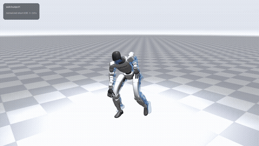

# SuperMimic on 8 GB — 消费级笔记本上的人形全身动作跟踪

> 复现 [SuperMimic](https://arxiv.org/abs/2610.28480)（CoRL 2026，UC Berkeley）：用一个可微世界模型 + 短时域 BPTT 训练 Unitree G1 的全身动作跟踪策略。
> **在一台 RTX 4060 Laptop（8 GB 显存）上，用论文 1/8 的并行环境数跑出 40 条 LAFAN1 动作 0.854 的归一化回报。**

`Windows 11` · `RTX 4060 Laptop 8GB` · `mjlab` · `MuJoCo Warp` · `PyTorch 2.14` · `LAFAN1 ×40`



*实体机器人 = 策略，半透明蓝色 = 参考动作。这条 `walk4_subject1` 的归一化回报是 0.949。*

<details>
<summary>English</summary>

An end-to-end reproduction of *SuperMimic: Scaling Humanoid Whole-Body Control with One Differentiable World Model* on consumer hardware. Trained a Unitree G1 whole-body motion tracker on 40 retargeted LAFAN1 clips using a single RTX 4060 Laptop GPU with 8 GB VRAM — **512 parallel envs (1/8 of the paper), imagination horizon 16 (1/2), pure eager mode (no `torch.compile`)**. Reached a **0.854 macro-averaged normalized return with 7/40 failures** after 126.5k iterations (53.2 GPU-hours), versus 0.82 reported for LAFAN1 in the paper and 0.904 from the upstream reproduction on an RTX 5090 with anchor-relative observations.

The report also documents four engineering blockers specific to this setup: recurring `CUDA error 715 (illegal instruction)` crashes requiring an auto-resume supervisor, evaluation processes that cannot coexist with training on the same GPU, a NaN divergence at iteration 126,900, and the Windows toolchain workarounds.

</details>

---

## 结果

LAFAN1 40 条动作，每条从首帧起播一次、确定性策略、无观测/动作噪声、无域随机化（论文 Appendix F 协议）。

| 指标 | 论文（LAFAN1，1×H100，1.2 h） | 上游复现（1×5090，3.3 h） | **本机（1×4060 8G，53.2 h）** |
|---|---|---|---|
| 归一化回报（宏平均） | 0.82 | **0.904** | **0.854** |
| 归一化回报（帧长加权） | — | — | **0.859** |
| 失败条数 / 40 | — | 3 | **7** |
| 世界模型 8 步误差 | 0.007–0.011 | 0.0065–0.0099 | 0.0131 |
| 观测口径 | 论文 | 锚点观测 | 锚点观测 |

**强项**：行走类全线 0.90 以上，最高 `walk4_subject1` **0.949**（超过上游 40 条均值）。
**弱项**：摔倒起身 `fallAndGetUp` 一族全部低于 0.80，最差 **0.667**——想象时域从 32 砍到 16 后，落地多点接触在 0.32 秒内无法体现。

完整逐条成绩、训练曲线、失败分析见 **[docs/REPORT_8G.md](docs/REPORT_8G.md)**。

---

## 与论文 / 上游配置的差异

| 项 | 论文 | 上游复现 | 本机 | 说明 |
|---|---|---|---|---|
| 并行环境 | 4096 | 4096 | **512** | 显存所限 |
| 想象 batch | 4096 | 4096 | **512** | 同上 |
| 想象时域 H | 32 | 32 | **16** | 论文 §4.3：配 critic 时 16 ≈ 无 critic 的 32 |
| 世界模型 batch | 10 × 2048 | 10 × 2048 | **10 × 1024** | 降低峰值，规避崩溃 |
| `torch.compile` | 开 | 开 | **关** | Windows 无 MSVC/triton |
| 观测 | 论文口径 | +锚点观测 | +锚点观测 | 与上游一致 |
| 数据集 | BONES-SEED 129,514 条 | LAFAN1 40 条 | LAFAN1 40 条 | 全库 fp16 需 6.7 GB |

峰值显存 **2.6 GB**；模型仅 18 M 参数（世界模型 8.82 M + 策略 8.91 M + critic 0.237 M），显存全被并行仿真与 BPTT 激活占用。

---

## 快速开始

```bash
# 环境（Python 3.12 + uv）
uv sync --group dev

# 数据：LAFAN1 G1 重定向版 40 条，ModelScope 国内直连
#   unitreerobotics/LAFAN1_Retargeting_Dataset  →  data/raw/lafan1_ms/g1/
.venv/Scripts/python.exe scripts/data/csv_to_npz_batch.py \
    --input-dir data/raw/lafan1_ms/g1 --output-dir data/npz/lafan1 \
    --input-fps 30 --workers 16          # 输出 40 条 50Hz npz，总计 2.451 h

# 训练（带崩溃自动续训，8 GB 配置）
.venv/Scripts/python.exe tools/supervise_8g.py --hours 30 --ckpt-interval 500

# 评测（务必先停训练，否则会触发 CUDA 715）
.venv/Scripts/python.exe tools/snapshot_8g.py
```

### 两处必改

否则起不来：

| 文件 | 改动 |
|---|---|
| `src/supermimic/world_model/wm_trainer.py` | `compile` 默认值 `"default"` → `None` |
| `src/supermimic/imagination/policy_trainer.py` | 同上 |

原因：Windows 无 MSVC/triton 编译链；且 `tyro` 会把命令行传入的 `none` 当字符串交给 `torch.compile`。

`--env.anchor-obs` **只需开启一次**——`loop.py` 会自动同步 `policy.goal_dim`（680 → 689）和 `policy_trainer.anchor_obs`，不要重复传。

### 两个环境坑

**`uv sync` 拉 mjlab 断流**（`RPC failed; curl 56 schannel` 或 `early EOF`）：

```bash
git init /tmp/mjlab && cd /tmp/mjlab
git remote add origin https://github.com/mujocolab/mjlab
git fetch --depth 1 origin 8bb2bc9e187797689ec82c78c35019afd2fd0376
git checkout FETCH_HEAD
# 然后 pyproject.toml:  mjlab = { path = "/tmp/mjlab" }
```

版本仍是 1.6.0，与 `uv.lock` 一致，其余 161 个包不受影响。

**在 Linux / 有 MSVC 的机器上**，建议把两处 `compile` 默认值改回 `"default"`（编译后快 2–3 倍）：

```bash
.venv/Scripts/python.exe -m supermimic.scripts.train \
    --wm-trainer.compile default --policy-trainer.compile default ...
```


---

## 仓库结构

```
src/supermimic/            世界模型 / 想象训练器 / mjlab 任务（上游代码）
scripts/                   数据转换、评测、录制、渲染
tools/
  supervise_8g.py          崩溃自愈守护进程（本仓库新增）
  snapshot_8g.py           一键评测+录像+进度表（本仓库新增）
docs/
  REPORT_8G.md             ★ 复现报告：结果对比、逐条成绩、故障分析
  UPSTREAM_README.md       上游原始 README（含 BONES-SEED 大规模流程）
  WIN_8G_TRAINING.md       8 GB / Windows 方案设计与实测
  PAPER_SPEC.md            论文全部数值与公式的逐条转录
```

---

## 已知问题

这些都是实测踩到的，不是猜测：

1. **`CUDA error 715 (illegal instruction)` 高频崩溃**。平均每 1 小时一次，栈在 `wm backward`。Warp 启动时打印 `Toolkit 13.4 / Driver 13.0`，驱动版本低于工具链，疑为主因。**升级显卡驱动到支持 CUDA 13.4 的版本**是根治方向；本仓库用「500 迭代存档 + 自动续训」扛住（54 个子进程全部崩溃，训练仍推进到 12.65 万迭代）。
2. **评测进程不能与训练共存**。同卡并发时 `eval_benchmark.py` / `record_rollout.py` 在第一次 `env.step` 立刻崩（15 次尝试 0 成功）；停训后单跑 100% 成功。**所有评测都必须先停训练。**
3. **`eval_benchmark.py` 本身不稳定**，即使不并发也可能崩。本仓库的指标全部改用 `record_rollout.py` 逐条输出的「跑完步数 / 总步数 / 回报」计算，信息量等价但走另一条代码路径。
4. **长跑会发散**。第 126,900 迭代世界模型在 50 步内变 NaN，之后 3,700 次迭代作废。交付模型回退到 `ckpt_0126500.pt`。长跑建议加 NaN 检测 + 自动回滚。

Windows 侧的其余坑（uv 拉 github 断流、`tyro` 的 `list[str]` 只认最后一个、缺 ffmpeg）见报告第 5.4 节。

---

## 未做

- **真机部署**：ONNX/JIT 导出、`unitree_sdk2` 推理、50 Hz 参考帧时钟对齐。上游两个实现都未覆盖。
- **BONES-SEED 大规模库**（129,514 条）：fp16 库 6.7 GB，8 GB 显存放不下。
- **速度接口**（论文 §4.5 的 RL encoder vs 蒸馏对比）。

---

## 致谢

- 论文：Liao et al., *SuperMimic: Scaling Humanoid Whole-Body Control with One Differentiable World Model*, CoRL 2026, [arXiv:2610.28480](https://arxiv.org/abs/2610.28480)
- 上游复现代码：[`CuboiLeo/SuperMimic-Reproduced`](https://github.com/CuboiLeo/SuperMimic-Reproduced)
- Windows / 8 GB 适配与方案文档：`flybyf/supermimic-win-8g-vram`（Gitee）
- 动作数据：LAFAN1（Harvey et al., 2020），G1 重定向版由 Unitree 发布于 ModelScope
- 仿真框架：mjlab、MuJoCo Warp

本仓库在以上工作的基础上完成：8 GB 硬件上的端到端复现与 12.65 万迭代训练、崩溃自愈守护与快照工具、Windows 环境四处阻塞的解决、40 条全量评测与发散事故分析。代码版权与许可见 `LICENSE` 与 `LICENSES/`。

---

## 注意：不要把这些推上 GitHub

`.gitignore` 已排除，但如果你重新建仓库请确认：

| 路径 | 大小 | 原因 |
|---|---|---|
| `logs/` | 数个 GB | 存档每个 215 MB，GitHub 单文件上限 100 MB |
| `data/` | 87 MB + npz | 动作数据，版权归原数据集 |
| `snapshots/` | 数百 MB | 录像与轨迹 |
| `.venv/`、`.bin/` | 数 GB | 环境与 ffmpeg 二进制 |

训练好的策略（`ckpt_*.pt`）建议放 Release 或 Hugging Face，不要提交到 git。
